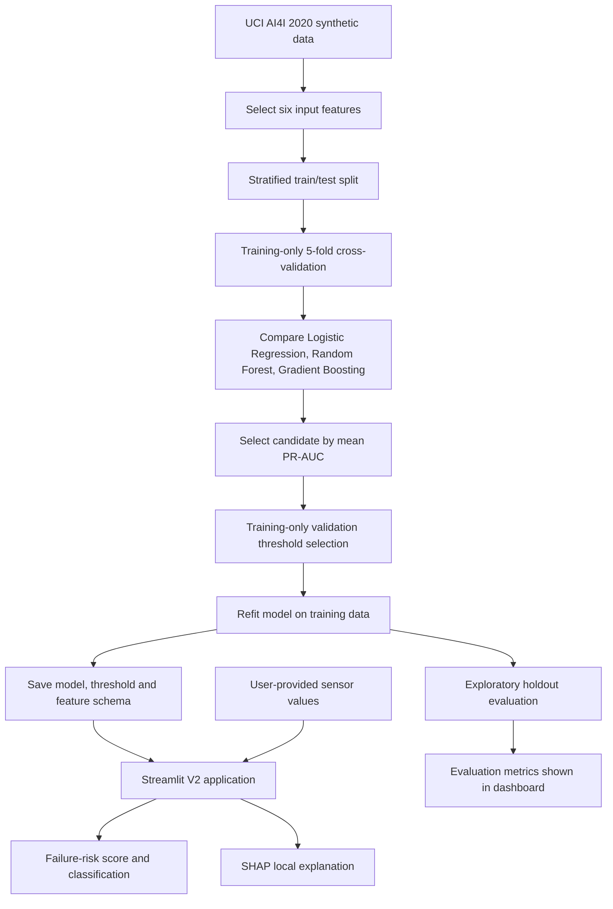

# PredictAI — Intelligent Predictive Maintenance

**End-to-end machine learning for industrial equipment failure-risk classification.**

[** Launch the live PredictAI V2 demo**](https://predictai-intelligent-predictive-maintenance-klw3qpbyhhvgppp4k.streamlit.app/) · [**Explore the source code**](https://github.com/sadasivannairveena-maker/predictai-intelligent-predictive-maintenance)

PredictAI is a portfolio project that estimates machine-failure risk from operating measurements, explains individual model predictions with SHAP, and presents evaluation results in an interactive Streamlit dashboard. It uses the **UCI AI4I 2020 Predictive Maintenance dataset**, which contains **10,000 synthetic observations**.

> **Scope:** Educational proof of concept on synthetic, tabular data. This is **not** a production maintenance system, and its model scores are not calibrated real-world failure probabilities.

## Features

- **Interactive prediction:** Adjust machine type, air/process temperatures, rotational speed, torque, and tool wear.
- **Gradient Boosting model:** Predict a failure-risk score and classify records using a validation-selected **0.25 threshold**.
- **Local explainability:** Generate SHAP waterfall plots explaining which inputs raise or lower an individual prediction.
- **Model evaluation:** Inspect precision, recall, F1, ROC-AUC, PR-AUC, and a confusion matrix.
- **Reproducible training workflow:** Compare three models with stratified 5-fold cross-validation, select a candidate using PR-AUC, tune its decision threshold, and save the results.

## System architecture



The preprocessing step is included in each scikit-learn pipeline, so it is fitted only on the relevant training fold during cross-validation. The five failure-mode indicator columns (`TWF`, `HDF`, `PWF`, `OSF`, `RNF`) are **excluded** from predictors to avoid target leakage.

## Results

### Model comparison (5-fold stratified cross-validation)

Scores below are the **mean validation scores over five folds** on the 8,000-record training partition. Classification-based metrics use each model's default threshold; PR-AUC and ROC-AUC use prediction scores across thresholds.

| Model | Precision | Recall | F1 | ROC-AUC | PR-AUC |
|---|---:|---:|---:|---:|---:|
| **Gradient Boosting** | **0.8606** | 0.6460 | **0.7366** | **0.9735** | **0.8112** |
| Random Forest | 0.7495 | 0.4652 | 0.5728 | 0.9630 | 0.6899 |
| Logistic Regression | 0.1374 | **0.8044** | 0.2346 | 0.8965 | 0.4409 |

**Selection:** Gradient Boosting had the highest mean cross-validation PR-AUC among the three tested configurations. The classification threshold **0.25** was subsequently selected to maximize F1 on a training-only validation split.

### Gradient Boosting exploratory holdout results

| Metric | Result |
|---|---:|
| Accuracy | 98.25% |
| Precision | 72.00% |
| Recall | 79.41% |
| F1 | 0.7552 |
| ROC-AUC | 0.9767 |
| PR-AUC | 0.8398 |
| Failure cases detected | 54 / 68 |
| False alarms | 21 |
| Missed failures | 14 |

Confusion matrix (rows = actual, columns = predicted):

| | Predicted normal | Predicted failure |
|---|---:|---:|
| **Actual normal** | 1,911 | 21 |
| **Actual failure** | 14 | 54 |

**Evaluation caveat:** The 2,000-record holdout was inspected repeatedly while developing this project; these results are **exploratory**, not a fully independent performance estimate. The project does not claim generalization to real industrial equipment. A future evaluation should use new independently held-out data or nested cross-validation.

## Tech stack

**Python · pandas · NumPy · scikit-learn · SHAP · Streamlit · Plotly · Matplotlib · joblib · UCI ML Repository**

## Repository layout

```text
.
├── app.py                       # Original Random Forest dashboard (V1)
├── app_v2.py                    # Gradient Boosting + SHAP dashboard (V2)
├── requirements.txt             # Streamlit deployment dependencies
├── requirements-train.txt       # Training dependencies
├── src/
│   └── train.py                # Training, CV, threshold selection, evaluation
├── reports/
│   └── repro_model_comparison.csv
├── artifacts/
│   ├── features.joblib
│   ├── gradient_boosting_model.joblib
│   ├── gradient_boosting_threshold.joblib
│   ├── gradient_boosting_metrics.json
│   ├── shap_background.joblib
│   └── ...                     # V1 and optional reproduction artifacts
└── README.md
```

## Run locally

Clone the repository:

```bash
git clone https://github.com/sadasivannairveena-maker/predictai-intelligent-predictive-maintenance.git
cd predictai-intelligent-predictive-maintenance
```

Install the dashboard requirements in a virtual environment:

```bash
python -m venv .venv
# macOS / Linux:
source .venv/bin/activate
# Windows PowerShell:
# .venv\Scripts\Activate.ps1
pip install -r requirements.txt
```

Run Version 2:

```bash
streamlit run app_v2.py
```

The app expects the committed `gradient_boosting_*.joblib`, `shap_background.joblib`, `features.joblib`, and `gradient_boosting_metrics.json` files in `artifacts/`.

### Reproduce model training

With a compatible Python environment, install training dependencies and run:

```bash
pip install -r requirements-train.txt
python src/train.py
```

This downloads dataset ID **601** from the UCI repository and writes separately named outputs (`artifacts/repro_*` and `reports/repro_model_comparison.csv`) without replacing the existing deployed V2 model.

The training run reported **Python 3.13.18** and **scikit-learn 1.6.1**. The deployed dashboard uses a separately configured **Python 3.11** environment. Serialized scikit-learn models may be incompatible across environments; use the supplied dependency specifications and verify model loading rather than assuming all Python versions are interchangeable.

## Explainability

The SHAP waterfall chart shows **local contributions to the model output** for the currently selected sensor values. Red contributions increase the modeled failure score; blue contributions decrease it. A reconstruction check is performed before displaying the explanation.

**SHAP does not establish causation.** Its contributions describe the learned model, not which component physically caused a machine to fail.

## Limitations and next steps

- The source dataset is **synthetic**, not live data from an industrial plant.
- Observations are treated as independent classification records; there is no streaming ingestion or temporal sequence modeling.
- The model predicts a failure label rather than **remaining useful life** or time-to-failure.
- Scores have not been calibrated or validated for real-world operational risk.
- The previously inspected holdout cannot support a fresh, unbiased final estimate.
- Future work: nested cross-validation or external validation, calibration, drift monitoring, and automated tests/CI.

## Dataset

UCI Machine Learning Repository: [AI4I 2020 Predictive Maintenance Dataset (ID 601)](https://archive.ics.uci.edu/dataset/601/ai4i+2020+predictive+maintenance+dataset).

---

**[Try PredictAI V2 →](https://predictai-intelligent-predictive-maintenance-klw3qpbyhhvgppp4k.streamlit.app/)**
